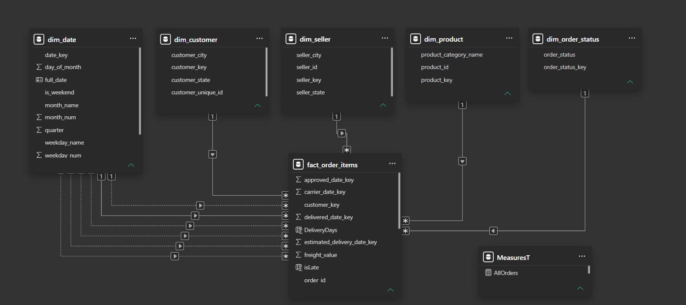
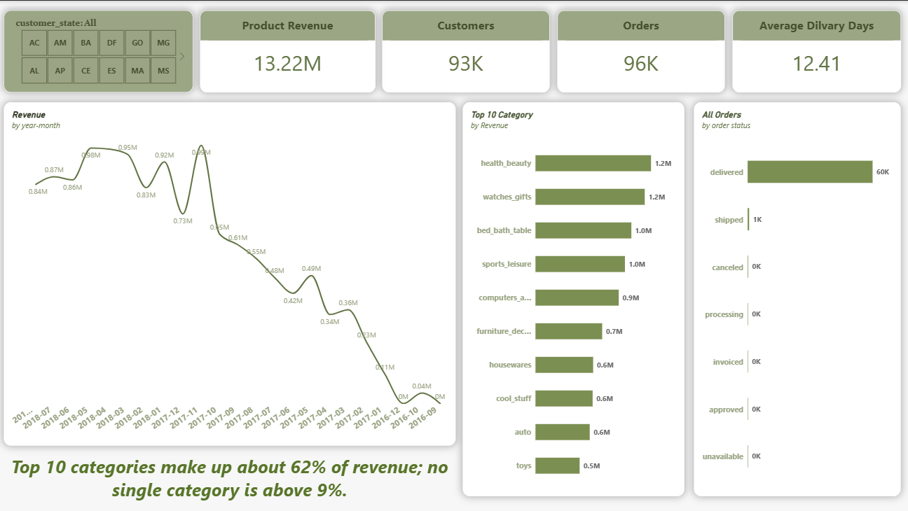
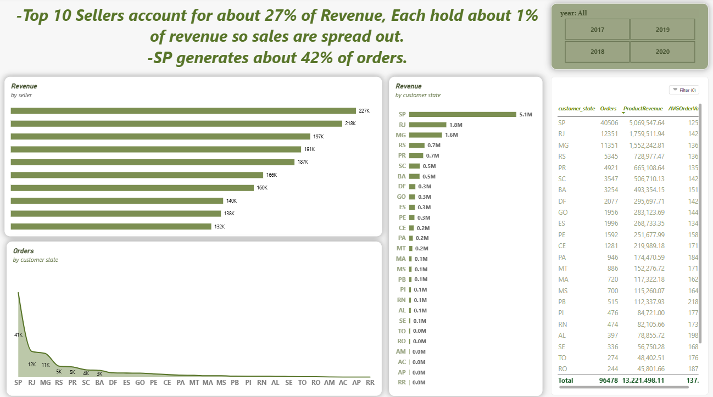
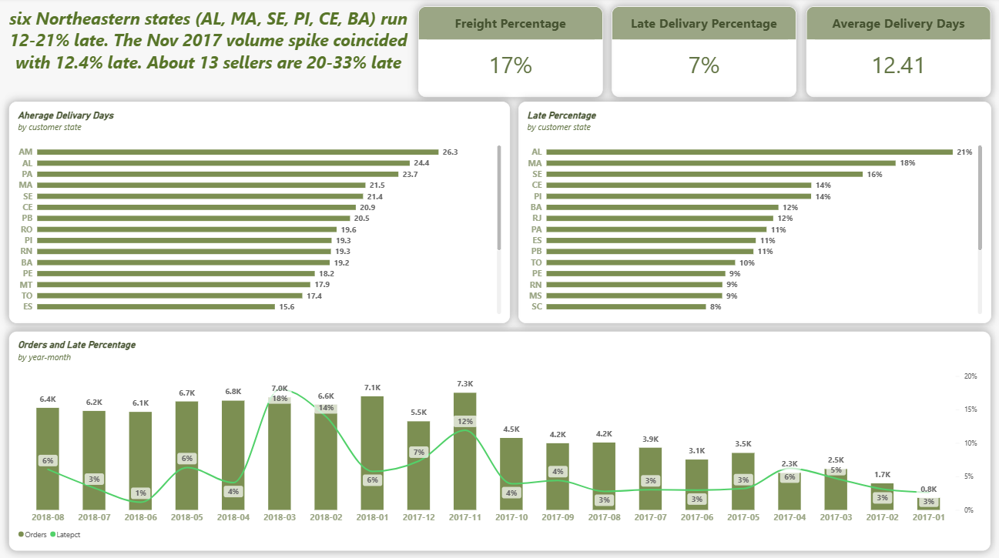

# Olist E-Commerce Analysis: SQL Server Data Warehouse + Power BI

An end-to-end analytics project on the Olist Brazilian e-commerce dataset: I built a star-schema data warehouse in SQL Server, answered business questions with T-SQL (descriptive, diagnostic, prescriptive), and presented the results in a 3-page Power BI dashboard.

## Business questions
1. How big is the business, and how did sales change over time?
2. What sells, where, and who sells it?
3. Why are some regions weaker? Where and when do late deliveries happen?
4. Do customers come back?
5. What should the business do about it?

## Tools
- **SQL Server / T-SQL:** data warehouse, views, analysis queries (CTEs, window functions)
- **Power BI:** data model, DAX measures, dashboard
- **Dataset:** [Olist Brazilian E-Commerce](https://www.kaggle.com/datasets/olistbr/brazilian-ecommerce) (orders, items, customers, sellers, products)

## Data model (star schema)
- **Fact:** `fact_order_items` (grain: one row per order item; keys to the date dim for purchase, delivered, and estimated delivery dates)
- **Dimensions:** `dim_customer`, `dim_product`, `dim_seller`, `dim_status`, `dim_date`

## Metric definitions
| Metric | Definition |
|---|---|
| Product Revenue | `SUM(price)` for orders with status = delivered (freight excluded) |
| Orders | `COUNT(DISTINCT order_id)`, delivered only (the fact table is at item grain) |
| Customers | `COUNT(DISTINCT customer_key)`, delivered only (`customer_id` changes with every order) |
| AOV | Product Revenue / Orders |
| Delivery days | Delivered date minus purchase date |
| Late order | Delivered date later than the estimated delivery date |
| Late % | Late orders / delivered orders with a valid delivered date |
| Freight % | Freight value / item price |
| Repeat rate | Customers with more than one delivered order / all customers |

Note: Olist's own revenue (commissions) is not in the dataset, so "revenue" here means product sales value.

## Key findings

### Descriptive
- About **97% of orders are delivered**; the remaining 3% (canceled, unavailable, in transit) are excluded from revenue.
- **Total scale:** 93,358 customers; roughly 96.5k delivered orders; product revenue of about $13.2M; average order value about 137. 
- **Categories are diversified:** the top 5 categories make up about 39% of revenue and the top 10 about 62%. The largest, health_beauty, has only 9.3%. About 17 of 74 categories produce roughly 80% of revenue.
- **Revenue vs. units differ:** bed_bath_table sells the most units but ranks #3 in revenue, while watches_gifts is #2 in revenue with fewer units (higher price per item).
- **Geography:** São Paulo (SP) generates about 42% of orders.
- **Sellers:** sales are spread across many sellers; no single seller dominates.

### Diagnostic
- **Late deliveries concentrate in Northeastern states.** AL, MA, SE, PI, CE, and BA run **12-21% late** with **19-24 days** average delivery, versus **4.5%** and **8.7 days** in SP.
- **Freight tracks distance:** freight is about 14% of item price in SP but 19-28% in remote states.
- **RJ is a high-volume problem:** 12,351 orders with 12.1% late.
- **Seller concentration of lateness:** about 13 sellers (30+ orders each) are **20-33% late**, while many sellers have 0%.
- **Lateness is not driven by category:** most categories sit at 5-8% late.
- **Seasonality:** in Nov 2017 orders rose about 63% over October (4,478 to 7,288) and late deliveries rose from 4.2% to **12.4%**. Feb-Mar 2018 were worse (14.1% and 19.0%) without a volume jump, which needs further investigation.
- **Retention is low:** only **3.0%** of customers (2,801) ordered more than once.

## Recommendations
1. **Improve delivery in the six Northeastern states (AL, MA, SE, PI, CE, BA) and RJ.** Add regional carriers or fulfillment points, and set more realistic delivery estimates. Prioritize BA and RJ by volume.
2. **Review underperforming sellers.** About 13 sellers have 20-33% late rates. Set a target late rate, warn them, and suspend repeat offenders, starting with the high-volume ones.
3. **Prepare for peak season.** Add logistics capacity and carrier agreements before Black Friday, and investigate the Feb-Mar 2018 spike.
4. **Test a retention campaign.** With a 3% repeat rate, growth depends on new customers. Pilot a post-purchase offer and measure the lift.
5. **Test freight subsidies in remote states,** where freight is 19-28% of price, and compare sales per customer before and after.

These are hypotheses to test, not proven causes.

## Dashboard
Three pages, built in Power BI from the warehouse tables:
1. **Sales overview:** KPIs, monthly revenue, top categories, order status
2. **Geography and sellers:** revenue by state, top sellers
3. **Delivery performance:** delivery days and late % by state, orders vs. late % by month, late sellers

## Data quality notes
- Delivered orders with an unknown delivered-date key (`-1` in the date dimension) were excluded from delivery metrics. Without this filter, they produced negative delivery times and distorted averages (for example, SP showed 1.2 days instead of 8.7).
- Some product category names are misspelled or split (e.g. `costruction_tools_garden`, two `home_appliances` categories, several fashion categories), and about 1.3% of revenue has no category.
- Small states (RR, AP, AC) have fewer than 100 orders, so their rates are unreliable and are filtered out of rankings.

## Limitations
- In Power BI, Late % and average delivery days are calculated per order item, so they differ slightly from the per-order SQL results.

